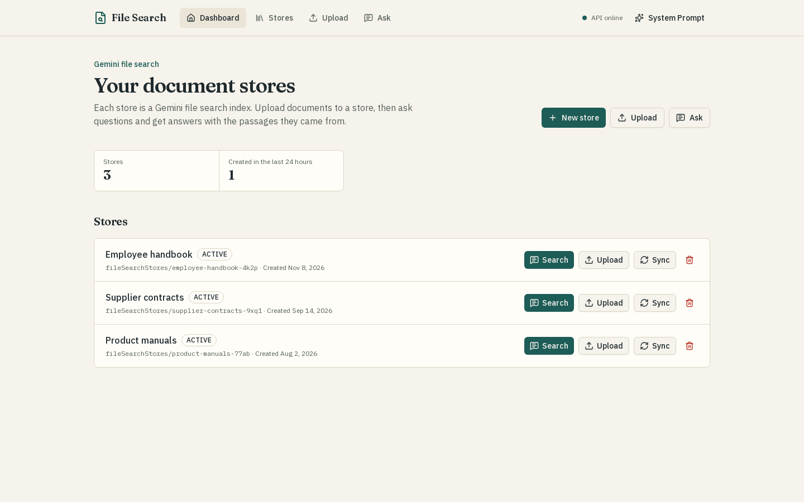
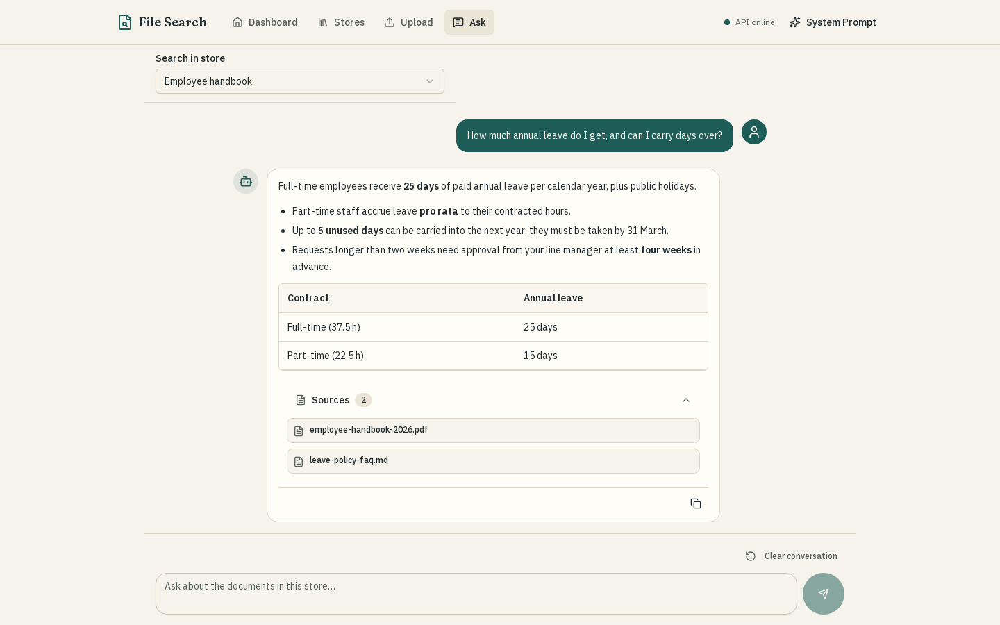
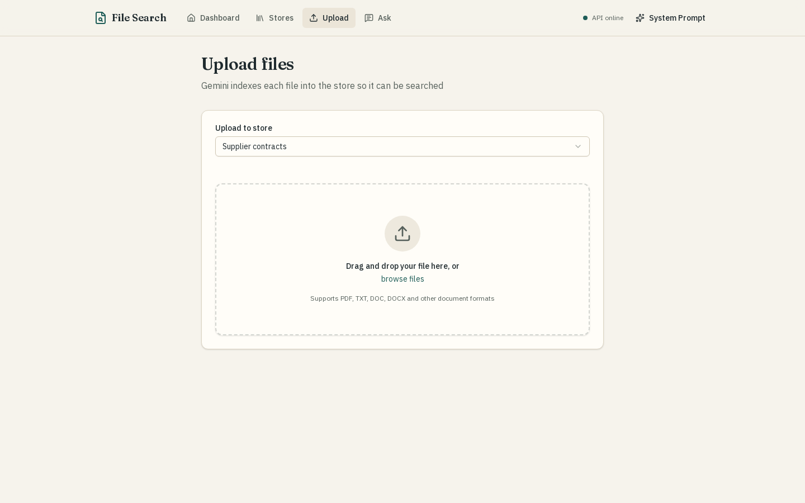
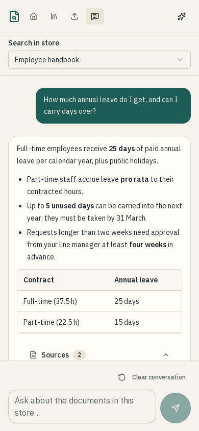
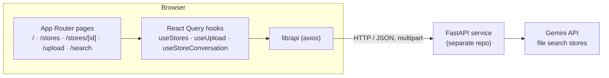

# Gemini File Search (frontend)

A Next.js client for [Gemini file search](https://ai.google.dev/gemini-api/docs/file-search) stores. You create a store, upload documents to it, and ask questions; the answer comes back as Markdown with the source documents it drew on. Follow-up questions carry the earlier turns as context.

This repository is only the browser app. Store management, uploads and the Gemini calls live in a separate FastAPI service, which is not included here. The app talks to it over the HTTP API described [below](#backend-api-contract), so any backend that implements those endpoints will work.



## What it does

- **Stores.** List, create, sync and delete file search stores, or delete all of them at once.
- **Upload.** Pick a store, then drag a file onto the drop zone or browse for one. A progress bar tracks the upload, and the request has no client timeout because the backend replies only after Gemini has indexed the file.
- **Ask.** Choose a store and ask questions in a chat view. Answers render GitHub-flavoured Markdown (tables, lists, highlighted code), and each answer lists its sources. The last ten messages (five question/answer pairs) go with each request as `conversation_history`.
- **System prompt.** An optional instruction, saved in `localStorage`, that is sent with every question.
- **API status.** The header calls `GET /health` on load and shows whether the backend is reachable.

| Asking a question | Uploading | Phone |
| --- | --- | --- |
|  |  |  |

The screenshots use demo stores and a mocked backend; no real documents or API keys are involved.

## Running it

You need Node.js 22 (see `.nvmrc`) and a running backend.

```bash
cp .env.example .env.local      # then set NEXT_PUBLIC_API_URL if your backend is not on 127.0.0.1:8000
npm ci
npm run dev                     # http://localhost:3000
```

For a production build:

```bash
npm run build
npm start
```

`NEXT_PUBLIC_API_URL` is inlined into the browser bundle at build time, so set it before `npm run build`. The backend has to allow the app's origin through CORS, because the browser calls it directly.

Without a backend the app still loads: the header shows "API unreachable" and the store list shows an error with a hint to check `NEXT_PUBLIC_API_URL`.

### Docker

```bash
docker build --build-arg NEXT_PUBLIC_API_URL=http://127.0.0.1:8000 -t gemini-file-search-fe .
docker run --rm -p 3000:3000 gemini-file-search-fe
```

The image uses Next.js standalone output and runs as the unprivileged `node` user.

| Variable | Used | Default |
| --- | --- | --- |
| `NEXT_PUBLIC_API_URL` | Base URL of the FastAPI backend, read at build time | `http://127.0.0.1:8000` |

## Tests and lint

```bash
npm test        # Vitest + Testing Library, 44 tests
npm run lint    # ESLint with the Next.js and React Compiler rules
```

The tests run in jsdom against an [MSW](https://mswjs.io/) mock of the backend, and any request without a handler fails the test, so nothing reaches a real server or Gemini. They cover the request shapes, FastAPI error parsing, the conversation hook (history, the ten-message cap, the system prompt, failed questions), and the upload, search and store pages, including a check that HTML in a model answer is shown as text.

## How it is put together



```
src/
  app/                 pages (all client components) and their tests
  components/
    layout/            header with navigation and API status
    stores/            store rows, picker, create/delete dialogs
    query/             question box, conversation view, sources, system prompt
    upload/            drop zone with progress
    ui/                shadcn/ui primitives (Radix + Tailwind)
  lib/
    api/               one module per resource; a shared axios client
    hooks/             React Query wrappers; toasts on success and failure
    systemPrompt.js    localStorage-backed store read with useSyncExternalStore
  test/                MSW server, demo data, render helpers
```

Some decisions worth knowing about:

- **The server is the source of truth.** Store data lives only in React Query's cache. Every mutation invalidates the `stores` query instead of patching the cache, which is simple and correct for a list of a few stores.
- **Conversation state is local.** `useStoreConversation` keeps the messages in component state and sends a trimmed copy with each question, so the backend can stay stateless. Changing store or pressing "Clear conversation" starts over. Nothing is persisted, so a reload starts a new conversation.
- **Markdown, not HTML.** Answers go through `react-markdown` with GFM and syntax highlighting but without raw-HTML support, so markup in a model answer (or in a document it quotes) is shown as text.
- **Store names are used as-is in URLs.** Gemini store names look like `fileSearchStores/abc123`. The app URL-encodes them in its own routes (`/stores/fileSearchStores%2Fabc123`) but sends them unencoded in API paths (`/api/stores/fileSearchStores/abc123/query`), so the backend's routes have to accept a slash in the store name, as FastAPI's `{store_name:path}` does.

## Backend API contract

These are the requests the app makes and the response fields it reads. The examples show what the client sends; the response bodies are the shapes it expects, the same ones used in the test mocks.

| Method and path | Used for |
| --- | --- |
| `GET /health` | header status dot |
| `GET /api/stores` | store list, pickers, dashboard counts |
| `POST /api/stores` | create a store |
| `DELETE /api/stores` | delete every store |
| `DELETE /api/stores/{store_name}` | delete one store |
| `POST /api/stores/{store_name}/sync` | sync a store |
| `POST /api/stores/{store_name}/files` | upload one file (multipart field `file`) |
| `POST /api/stores/{store_name}/query` | ask a question |

List stores:

```http
GET /api/stores
```

```json
{
  "stores": [
    {
      "name": "fileSearchStores/employee-handbook-4k2p",
      "display_name": "Employee handbook",
      "create_time": "2026-11-08T21:05:00Z",
      "state": "ACTIVE"
    }
  ]
}
```

Create a store:

```http
POST /api/stores
Content-Type: application/json

{ "display_name": "Board minutes" }
```

Ask a follow-up question. `system_prompt` is included only when one is saved, and `conversation_history` only when there are earlier turns:

```http
POST /api/stores/fileSearchStores/employee-handbook-4k2p/query
Content-Type: application/json

{
  "prompt": "And for part-time staff?",
  "system_prompt": "Answer in one short paragraph.",
  "conversation_history": [
    { "role": "user", "content": "How many days of annual leave do I get?" },
    { "role": "model", "content": "Full-time employees receive **25 days** ..." }
  ]
}
```

```json
{
  "text": "Part-time staff accrue leave **pro rata** to their contracted hours ...",
  "sources": [{ "title": "employee-handbook-2026.pdf" }, { "title": "leave-policy-faq.md", "uri": "..." }]
}
```

Sync a store:

```http
POST /api/stores/fileSearchStores/employee-handbook-4k2p/sync
Content-Type: application/json

{ "document_name": "", "display_name": "Employee handbook" }
```

Errors are read FastAPI-style: a string `detail`, the first `msg` of a validation-error array, or a top-level `message`. The text is shown in a toast and, for questions, under the question that failed.

## License

[MIT](LICENSE)
